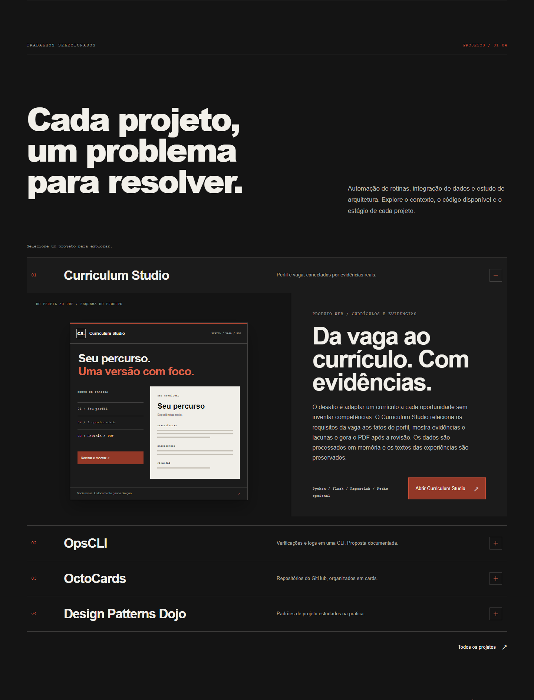
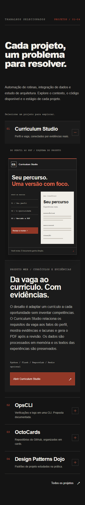

# Curriculum Studio no domínio do portfólio

A integração atende `https://samuelproenca.com/curriculumstudio` com um proxy
para o projeto Flask separado na Vercel. Não exige comprar outro domínio.
O endereço `vercel.app` do backend continua sendo uma origem pública.

## Destaque e identidade visual

Curriculum Studio é o primeiro trabalho selecionado da home. O texto explica
como o produto relaciona perfil e vaga, expõe evidências e lacunas e libera PDF
após revisão, mantendo as experiências originais. A página `/projetos` usa o
mesmo conteúdo e preserva a âncora `#curriculum`.

O botão **Abrir Curriculum Studio**, no próprio destaque, aponta para
`/curriculumstudio`. É um link HTML com navegação de documento: o destino é
uma aplicação Flask independente, sem prefetch/RSC do Next.js. O produto possui
um botão de retorno a `/#projetos`. Não há link para seu repositório privado.

- `src/content/projects.ts`: contexto, ordem e endereço do produto.
- `src/components/selected-works.tsx`: painel e botão de acesso.
- `src/components/curriculum-preview.tsx`: ilustração decorativa em HTML/CSS.
- `src/styles/curriculum-studio.css`: composição com os tokens existentes,
  versão mobile, foco de teclado e movimento reduzido.
- `src/app/projetos/page.tsx`: acesso também pelo arquivo de projetos.

O editor Flask compartilha os tokens de fundo, superfície, papel, terracota e
famílias tipográficas do portfólio. A ilustração não contém dados pessoais,
estatísticas inventadas ou chamadas externas.

Capturas locais, sem representar deploy em produção:

Testes de componente cobrem conteúdo, seleção, foco, ocultação de painéis e
destino do acesso. `tests/e2e/curriculum-studio.spec.ts` verifica navegação de
documento pela home e por `/projetos`, com a rota do app simulada. O fluxo real
por proxy local também foi validado com o Flask: análise, revisão, PDF e retorno.

Validação local em 23/10/2026: build, TypeScript, lint, formatação e 70 testes
unitários aprovados; 151 testes de navegador aprovados e oito dispensados
conforme o dispositivo. A execução usa o Chromium instalado no ambiente. O teste
de estabilidade dos links aguarda o fechamento e a abertura do accordion; as
verificações de hover aguardam o estado final sem presumir uma taxa de quadros.

## Ativação

1. Publique `SamuelBProenca/Curriculim_Service` como projeto Flask, raiz do repo.
2. Nesse projeto configure `SITE_URL=https://samuelproenca.com` e
   `SITE_BASE_PATH=/curriculumstudio`. Publique novamente.
3. No projeto **Portfolio**, configure `CURRICULUM_STUDIO_ORIGIN` com a origem
   pública HTTPS do Flask, por exemplo `https://seu-projeto.vercel.app`.
   Sem caminho, parâmetros ou credenciais. Publique novamente o portfólio.
4. Confirme editor, assets, análise, revisão e PDF no caminho público.
5. Confira `/robots.txt` e `/curriculumstudio/sitemap.xml`; envie o sitemap ao
   Search Console da propriedade já existente.

O proxy remove o prefixo antes de encaminhar. O Flask gera links, chamadas de
API, metadados e o caminho do cookie com o prefixo público. `next.config.ts`
preserva os redirecionamentos existentes. Sem a variável, não cria rewrites.

## Métricas e segredos

Os tokens Upstash, `METRICS_COOKIE_SECRET` e `METRICS_ADMIN_TOKEN` pertencem
somente ao ambiente do **projeto Flask**. Não entram neste repositório nem em
variáveis `NEXT_PUBLIC_`. O painel fica em `/curriculumstudio/admin/metrics`;
a chave é enviada em Authorization, nunca na URL.

As rotas de API e painel recebem `private, no-store` e `noindex`. A página
do currículo não é encapsulada em iframe. Uma futura configuração de AdSense
deve tratar `ads.txt` na raiz de **samuelproenca.com**, com uma conta real.

## Validar localmente

Com o backend de teste disponível em `http://127.0.0.1:8001`, defina
`CURRICULUM_STUDIO_ORIGIN` com essa origem e execute `npm run dev`. HTTP de
loopback só é aceito no desenvolvimento. Em produção, HTTPS é obrigatório.

O proxy deve preservar cabeçalhos de origem, cookies, método e corpo. No teste
local de POST, use Origin `https://samuelproenca.com`, que representa a origem
pública configurada do Flask. O deploy real deve confirmar a política de
cabeçalhos e eventuais proteções de acesso de ambos os projetos Vercel.

Referências: [rewrites Next.js](https://nextjs.org/docs/app/api-reference/config/next-config-js/rewrites)
e [rewrites externos Vercel](https://vercel.com/docs/rewrites).
